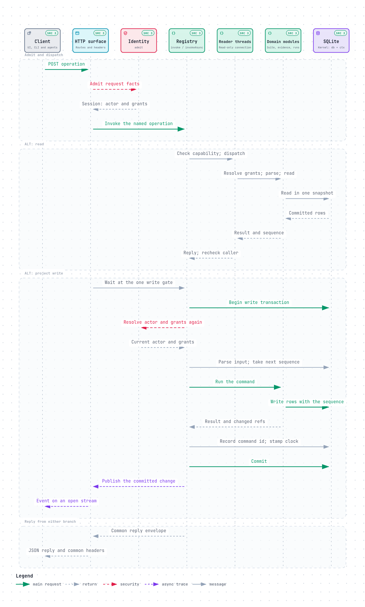

# How the code is organised

Mainworthy is one Bun process and one SQLite file. Every client, from the web UI to an agent, calls the same
operations, and every operation goes through one function. This page shows where the parts live, which imports
the module map allows, and the path a request takes. [docs/architecture.md](../architecture.md) has the full
design. Read it before you change identity, sessions, runs or policy.

## Find a directory

| Path | What it holds |
| --- | --- |
| `src/core/` | pure functions and schemas with no I/O: the case document, the outline grammar, Markdown, diff, three-way merge, hashes, failure signatures, policy presets, the verdict, the API's types. The browser and the server both run them. |
| `src/server/kernel/` | the SQLite wrapper, migrations, the command context, the `Witness`, configuration, blobs, the instance lock |
| `src/server/suite/` | cases, versions, folders, tags and proposals |
| `src/server/evidence/` | tests, targets, batches, results, causes, findings, flaky detection, quarantine, attachments, stats |
| `src/server/runs/` | change runs, planned runs, slots and the verdict |
| `src/server/decisions/` | questions, answers and the ledger of decisions, and the handlers for each kind of question |
| `src/server/identity/` | actors, tokens, sessions, passwords, passkeys, TOTP, OIDC, invitations, teams and the sign-in limiter |
| `src/server/policy/` | the clause table that says who answers each kind of question |
| `src/server/trackers/`, `src/server/statuses/` | defect issues on GitHub or Jira, and commit statuses on GitHub |
| `src/server/transfer/` | archive export and import, and audit export |
| `src/server/ops/` | the registry (`index.ts`, `registry.ts`), `invoke`, the reader threads, recovery jobs and tracker holds |
| `src/surfaces/` | HTTP, MCP, the JUnit reader, CI environment detection, archive routes, sign-in routes, the docs site, the web UI's files and the headers on every reply. Adapters only, no product logic. |
| `src/app/start.ts` | starts and stops the instance: database, HTTP, readers, recovery and periodic jobs |
| `src/cli/` | the `mainworthy` command. Most commands are generated from the registry. `commands/` holds the adapters, and `demo/` the pure demo catalog that `seed.ts` writes. |
| `src/web/` | the React web UI. One directory per screen, with `lib/` and `ui/` shared. `SHELL.md` is the contract a screen follows. |
| `ios/` | the SwiftUI iPhone app ([ios/README.md](../../ios/README.md)) |
| `skill/mainworthy/` | the skill that teaches an agent the case model. The server serves it as an archive. |
| `test/` | tests that cross modules, the architecture rules, the budgets and, in `test/e2e/`, the browser tests. Pure unit tests sit beside their code in `src/`. |
| `scripts/` | the check, the CI helpers, code generation, licences, diagrams, the iPhone tooling and `work.ts` |
| `bench/` | the benchmark and the load tools ([bench/README.md](../../bench/README.md)) |
| `docs/` | the user guide, decisions, architecture, deploy and these pages |

## Import down the module map

`test/architecture.test.ts` assigns every runtime TypeScript file to a layer and fails the check when an import
goes up. It reads static imports, dynamic `import()` calls and type-only imports. The layers, from the top, and
what each may import besides itself and `src/core`:

| Layer | May import |
| --- | --- |
| `src/cli` | `src/app`, `src/surfaces`, `src/server/ops`, `src/server/kernel`, `src/server/policy`, `src/web` |
| `src/app` | every server module and `src/surfaces` |
| `src/surfaces` | `src/server/ops`, `src/server/kernel`, `src/server/identity`, `src/web` |
| `src/server/ops` | every domain module below |
| `server/decisions` | `identity`, `policy`, `suite`, `evidence`, `runs` |
| `server/statuses` | `evidence`, `runs` |
| `server/trackers` | `evidence`, `suite` |
| `server/transfer` | `suite` |
| `server/runs` | `suite`, `evidence` |
| `server/evidence` | `suite` |
| `server/suite` | `policy` |
| `server/identity`, `server/policy` | only `server/kernel` |
| `src/web` | nothing but itself and `src/core` |

Every domain module may also import `server/kernel`, and no domain module imports `server/ops` or a layer above it.
[Diagram: the surfaces, the operations and the record](../diagrams/architecture.html) shows the same modules
with what each owns.

The CLI has three named exceptions: `client.ts`, `demo.ts` and `demo-worker.ts` may call identity,
and `demo.ts` may also call transfer, to reset and refill the demo project.

Three more rules come with the map, each held by the same test:

- Only `server/kernel` imports `bun:sqlite`.
- Each table has one owning module. SQL is declared with `sql()` in that module, and another module reads the
  rows through the owner's functions.
- `src/core` imports no I/O module, and `src/web` imports only itself and `src/core`.

If a change seems to need an import against the map, the design is wrong. Move the code, not the test.

## Follow a request

The web UI, the CLI, a pipeline and an agent all reach the server over HTTP: `POST /api/p/<project>/<op>` for a
project's operation, `/mcp` for agent tools. The surface reads what the request carries and asks identity who the
caller is. Then `invoke` in `src/server/ops/registry.ts` runs the operation.

Some facts about this path matter when you change it:

- A command id names one request. Sent again with the same content, it gets the first reply and writes nothing.
  Sent again with other content, it is refused. A client whose reply was lost asks `command` what became of it.
- A `report` commits twice. The first transaction accepts the results, and the second applies them in slices of
  200, so a large report does not block other requests for long.
- The web UI listens on the change stream and refetches only what an event says was touched (`changed` in
  `src/web/lib/data.ts`).

## Write what is current only through a decision

Versions, results, answers and decisions are append-only. A correction is a new row that names the one it
replaces. What is current, such as a case's head version, a test's link to a case, how a failure counts, whether
a run is closed and the policy in force, is called standing. Each kind of standing has one writer, and that
writer takes a `Witness` (`src/server/kernel/witness.ts`). Only the decision machinery in
`src/server/decisions/` can make one, and the database refuses a row that cites a decision the ledger does not
hold. So every change to what is current has a ledger row that says who decided, on what evidence and under
which policy clause.

If you need a new kind of standing, add a kind of decision for it. Do not add a writer without a witness. The
witness tests in `test/architecture.test.ts` fail if you do.

## Read next

- [Add an operation, a migration, a screen or a page](change-the-code.md)
- [docs/architecture.md](../architecture.md), for identity, sessions, the red build, runs, policy and headers
- [docs/product-design.md](../product-design.md), for the domain model the code implements
