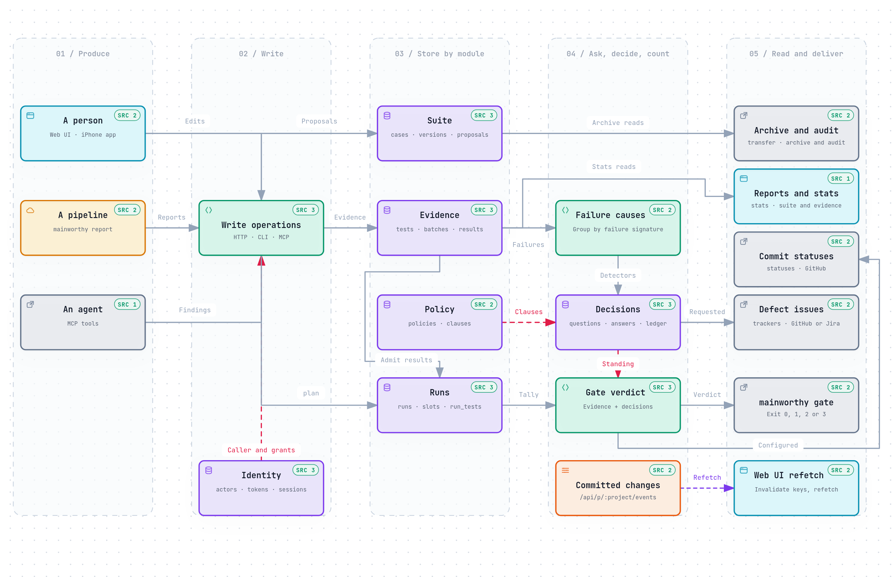

# What Mainworthy does today

This page describes what the code does at commit `35f1b3b` (2026-10-18): the features a person meets on each
surface, the workflows that cross modules, and where the data goes. It is a map for catching up. The steps for
using each feature are in the [user guide](guide/index.md), and the design behind them is in
[architecture.md](architecture.md). Where the two disagree with this page, the code decides. Fix the page.

## The idea

Mainworthy keeps three kinds of record. Cases say what the software should do, and each edit makes a new
version. Results say what people, pipelines and agents observed, all in one shape. Decisions say what people,
or the policy's rules, made of the results. A failure raises a question, one per cause. A decision answers the
question and is the only thing that can change what is current. The gate reads the evidence and the decisions in
force and gives each commit, change or run one verdict: `passed`, `failed`, `blocked` or `pending`.

The served [overview diagram](diagrams/overview.html) shows the same flow at a higher level. GitHub shows an HTML
file as text, so download a diagram or open it from a checkout in a browser.

## Where a person meets it

| Surface | Who uses it | What it reaches |
| --- | --- | --- |
| Web UI | people, on a desktop or a phone | every screen below. A phone gets one pane at a time and a palette for what keys do. |
| iPhone app | people | the queue, runs, cases, changes and the account (`ios/`) |
| `mainworthy` command | people and pipelines | every operation, plus adapters such as `report`, `gate`, `export` and `seed` |
| HTTP API | any client | every operation at `POST /api/p/<project>/<op>`, or `/api/<op>` for the four instance operations. The OpenAPI document comes from the same registry. |
| MCP | agents | ten of the operations as tools, at `/mcp` or through `mainworthy mcp` on stdin and stdout |
| `/docs` | anyone, with no session | the user guide, its diagrams and the agent skill as an archive |

Every surface calls the same 28 operations, which `OP_LIST` in `src/server/ops/index.ts` lists. The
[API reference](guide/api.md) has each one with its capability and input.

## Web screens

The sidebar lists the places of the work. Settings is in its footer.

| Screen | Key | What you can do there |
| --- | --- | --- |
| Suite | `g s` | Write a case with `c` as an outline, edit it with `e` or Enter, and filter with `/`. Select rows with `x`, move them with `m`, tag them with `t` or `#`, and undo with `u`. Space peeks at a case's timeline. `n f` makes a folder, `z` widens the detail. A draft is kept on the device and becomes a version when you leave the case, press `⌘ Enter` or pause for 30 seconds. |
| Case | from Suite | Read the case with its proof grouped by person, pipeline and agent. Compare versions step by step, resolve an overlapping edit with both drafts kept, and use shared step fragments pinned at a version. |
| Queue | `g q` | Read each open question with its evidence and answer with one key. Answer many of one kind at once (`x`, Shift, `*`), take an agent's advice, read the decided ledger and withdraw an answer with `u`. |
| Runs | `g r` | Plan a run with `n` from all cases, a folder, a tag or a search. Work it in the cockpit: digits mark steps, `p` pass, `f` fail with a note, `b` blocked, `s` skip, `u` corrects the last result. Attach screenshots or files. |
| Changes | `g c` | Read each change's gate verdict, its open and decided questions, the cases it touches and its results. Enter opens the question that blocks it. |
| Tests | `g t` | Browse automated tests, with or without a case. A test shows its key, case, flips, quarantine and recent results with commit, job, attempt, duration and failure message. |
| Reports | `g o` | Pass rate (filtered by pipelines, people or agents), flaky tests, time lost to reruns, automation and its backlog, and coverage by requirement, over 7, 14, 30 or 90 days. |
| Settings | `g ,` | Policy, Tokens, People (instance admins), Projects, Connect, Your home, Your sign-in and Your sessions |

Across every screen, `⌘ K` opens the palette. It searches cases, jumps to a `C-`, `Q-` or `R-` reference, runs
actions, switches projects and searches the docs. `?` lists the keys of the screen, `g d` opens its docs page,
`g p` switches project, `g h` goes to your saved home, `[` collapses the sidebar and `g x` signs out.
[Keyboard](guide/keyboard.md) lists every key.

### Settings

- **Policy.** Compare the `loose`, `standard` and `strict` presets, edit the clauses in order (the first match
  wins), preview how recent questions would route, and define custom fields for cases.
- **Tokens.** Make a token for an actor with capabilities and an expiry, list tokens and revoke them.
- **People.** List actors, change access, invite a person with a link, and forget a person while keeping the
  history. Teams group people and carry grants per project.
- **Projects** makes projects. **Connect** shows how to point a pipeline at the instance. **Your home** saves
  where the app opens for you.
- **Your sign-in** holds your password, passkeys, authenticator app and recovery email. **Your sessions** lists
  and ends your browser sessions.

## The iPhone app

The app has five tabs: Queue, Runs, Cases, Changes and You. It follows the project's change stream like the web
UI does.

- **Queue.** Open or decided questions, filtered by kind. Answer one or many, withdraw an answer, and link a
  test with no case to a chosen or new case.
- **Runs.** Plan a run from a selection and an optional commit, work it step by step and correct the last result.
- **Cases.** Browse folders and tags, search, read a case and its history, and edit the title, preconditions and
  steps. An overlapping edit is resolved one field at a time.
- **Changes.** Read changes, their runs, their results and the automated tests.
- **You.** The account, its tokens and sessions, and sign-out.

The app cannot yet sign in with a passkey, choose another instance than the one it was built for ([#233](https://github.com/endqwerty/mainworthy/issues/233)) or edit
shared fragments. [The iPhone app](guide/iphone.md) has the rest.

## The command line

Every operation is a command. These adapters do more than send one operation:

| Command | What it does |
| --- | --- |
| `serve` | starts the server and the web UI. It is the default command. |
| `report <files>` | reads JUnit XML, Playwright JSON, Jest or Vitest JSON, pytest JSON or TRX. It finds the commit, branch, pull request, job and attempt from CI or Git, and sends one batch. |
| `gate` | reads the verdict for a commit, change or run. It exits 0 passed, 1 failed, 2 blocked, 3 pending. |
| `new`, `get --md`, `fmt` | writes a case from Markdown or an outline, prints a case as Markdown, and formats case Markdown |
| `import`, `import-csv` | restores an archive into an empty instance, or proposes cases from CSV, TestRail or Qase |
| `export`, `audit` | writes an archive of an instance or a project, and exports or verifies an audit file |
| `token`, `actor`, `invite`, `login`, `policy` | manages tokens, actors and grants, invitations, a personal CLI token and the policy |
| `mcp` | serves MCP on stdin and stdout for an agent |
| `seed <project>` | fills a new project with a shop's suite, two weeks of history and a queue |
| `health`, `open`, `version` | checks that the server answers, prints its URL, prints the CLI and API versions |

[Command line](guide/cli.md) has every flag.

## Workflows

Each workflow names the functions that do its steps, so you can follow it in the code. The served diagrams each
show one of them in more detail.

### Write and change a case

[Diagram: the case lifecycle](diagrams/case-lifecycle.html)

1. The Suite editor keeps a draft on the device. Saving turns it into edits and calls `propose`. Saving and
   proposing are the same call.
2. `proposeSteps` (`src/server/ops/writes.ts`) has `suite.sealSteps` resolve the edits against the version
   each was based on. An edit that overlaps a newer version becomes a `conflict` proposal instead of overwriting
   it.
3. `decisions.raiseSteps` asks the policy who answers. Under `loose`, a rule accepts the edit at once. Under
   `standard`, an agent's edit waits for a person. Under `strict`, a person accepts every edit with a reason.
   Policy changes go to an admin, and conflicts go back to their author.
4. When the edit is accepted, the adoption handler calls `suite.adoptSteps` with a witness. The case gets its
   next version.
5. A conflict answered `merge` makes a new proposal against the current head, which goes through the policy
   again. A merge resolves one edit of one case.

An accepted edit is not withdrawn. To go back, propose the earlier version again, so both stay in the history.

### Report results and read the gate

[Diagram: one red build, from upload to a green gate](diagrams/red-build.html) ·
[Diagram: how a gate reaches its verdict](diagrams/gate-verdict.html)

1. `mainworthy report` parses the files and calls `report`. The producer is the token's actor.
2. **Accept.** `acceptReport` finds or creates the target, stores the batch, marks every run the commit matters
   to as waiting and enrols a GitHub commit status if one is configured. The gate reads `pending` from here.
   This transaction commits first, so accepted work survives a crash.
3. **Apply.** `processBatchSteps` applies the results in slices of 200. Each result gets its test, its basis
   (exact, assumed or unresolved) and a failure signature. Change runs and planned runs take the results they
   admit.
4. **Raise.** One `failure` question per cause and scope. A decision about that cause that still holds is
   carried forward, and nobody is asked. New tests with no case raise one `map` question per file, unless the
   policy tracks them or creates their cases.
5. **Verdict.** `decisions.refold` recomputes the affected runs. `gateOf` in `src/server/runs/runs.ts` reads the
   tally, the blocking questions, uploads still waiting, expired holds and missing shards. With nothing counted,
   the verdict is `pending`.

A pipeline's and a person's reports count in a change run. An agent's report is shown but counts only in a
planned run that asked for agents.

### Answer a question

[Diagram: the life of a question](diagrams/question-lifecycle.html) ·
[Diagram: how the policy routes a question](diagrams/policy-routing.html)

1. `inbox` lists the open questions, most blocking first, with a hash of the evidence each one saw.
2. `decide` sends one answer, many, or a withdrawal. `answerSteps` checks the answer against the evidence hash,
   the policy, who may answer and whether a reason is needed.
3. An answer that the policy counts becomes a decision, and its kind's handler changes what is current: it
   accepts a proposal, links or makes a test's case, excuses or attributes a failure, or closes a run. An
   answer that is only advice is recorded and changes nothing.
4. The answer keys for a failure are `d` defect, `t` the test is wrong, `e` expected (behaviour changed), `f`
   flaky, `i` infrastructure, `n` already failing on the base and `m` the failure was a mistake. Defect, test
   and expected make the gate fail until a fix passes. Flaky excuses the cause for up to 14 days or until its
   basis changes. Infrastructure excuses that build only.
5. `u` withdraws a decision. The handler undoes only what that decision made, and the question opens again.
   A periodic sweep ends holds that have run out, and the gate reads an expired hold as ended even before the
   sweep.

### Plan and work a run

[Diagram: a planned run](diagrams/planned-run.html)

1. `plan` picks the active cases and calls `runs.plan`. Each case gets a slot pinned at its current version.
2. Results already recorded on the run's commit fill slots at once, and failures among them raise questions.
3. A person works the slots in the cockpit. A pipeline's result on the same commit fills a slot when the run
   accepts automated results and the case admits that method.
4. A fail from one producer beside a pass from another is `disputed` until a person decides.
5. Closing a run is a `signoff` decision on a passed gate. Under `standard`, a rule closes a passed run. Under
   `strict`, a person closes it with a reason. A reopened run counts the evidence as it is now.

### Let an agent in

[Diagram: an agent's session, from token to a person's decision](diagrams/agent-access.html)

1. An admin makes an agent's token with a grant on a project. The secret is shown once.
2. The agent connects to `/mcp`, or runs `mainworthy mcp`, which forwards to the running server.
3. Ten operations are tools: `propose`, `report`, `claim`, `decide`, `inbox`, `get`, `find`, `impact`, `since`
   and `gate`. The instructions suggest starting with `impact` or `inbox`.
4. `claim` records a review of the current case versions, even one with no findings. Each finding raises a
   question for a person.
5. The policy decides whether an agent's answer counts, is advice or is refused. An agent's report never moves a
   change's gate.

### Sign in

1. A browser signs in with a name and password (with an authenticator code if one is enrolled), a passkey, an
   OIDC provider the instance names, or a token. A browser never keeps a token: `POST /api/login` opens a
   session and sets a cookie of which the server stores only a hash.
2. A person joins or recovers an account through an invitation link that works once, for up to 30 days. It can
   be sent by mail.
3. A session ends at sign-out, when what opened it is revoked, after 14 days unused or after 90 days.
4. `mainworthy login` exchanges a password for a personal CLI token, shown once.

### Move data in and out

- `mainworthy export` streams an archive of an instance or a project as NDJSON, with attachments. Secrets,
  sessions, credentials and invitations stay behind.
- `mainworthy import` restores an archive into an instance with no projects, in one transaction.
- `audit` exports the decisions, answers, policy changes and case versions as a file that can be verified
  offline.
- CSV import previews the mapped rows, then proposes the cases in one confirmation.

### Fill a demo

`mainworthy seed <project>` writes a shop's suite (2,000 cases by default) and 14 days of history through the
ordinary operations. A demo project accepts the time of each write, so the history has dates. The seed uses
temporary pipeline and agent tokens and revokes them when it ends.

### Reach the tracker and the pull request

- `tracker` queues a defect from a failed result. A worker creates or checks the issue on GitHub or Jira, and
  `tracker-status` reads the result. A defect decision holds until its issue is closed, which a poller notices.
- Where a project names a GitHub repository, a counted report enrols a commit status. A worker posts the gate
  as `mainworthy/gate`: `pending`, `success`, `failure`, or `error` for blocked.

### Read the reports

The Reports screen calls `stats` only. `stats` reads the results and the suite and keeps no table of its own.
The pass rate is passes divided by passes and failures that were not quarantined. A flaky test is one that
flipped between pass and fail on the same code. Reruns total the time of earlier attempts. Automation counts
active cases linked to automated tests. Coverage joins requirements, their cases and the latest results.

## Where the data lives

One SQLite file holds everything except attachment bytes, which are in a `blobs` directory beside it, by hash.
Each table has one owning module. Other modules read the rows through the owner's functions.

| Module | Tables | Written by | Read by |
| --- | --- | --- | --- |
| suite | `cases`, `versions`, `folders`, `placements`, `case_tags`, `case_aliases`, `proposals`, `requirements`, `covers`, `search_docs` | `propose`, CSV import and accepted decisions | `get`, `find`, `history`, `timeline`, `check`, `impact`, `since`, `plan`, `stats` |
| evidence | `targets`, `changes`, `change_ends`, `batches`, `tests`, `results`, `signatures`, `flips`, `excuses`, `result_excuses`, `findings`, `reviews`, `attachments`, `quarantines`, `artifacts`, `builds`, `deployments`, `scope_moves` | `report`, `change`, `claim`, `attach`, `announce` and failure decisions | `get`, `find`, `timeline`, `impact`, `gate`, `stats`, `attachment` |
| runs | `runs`, `slots`, `slot_results`, `run_tests`, `depends_on` | `plan`, `report` and decisions | `gate`, `get`, `find`, the detectors |
| decisions | `questions`, `question_refs`, `answers`, `decisions` | the detectors behind `propose`, `report`, `claim`, `plan` and `change`, and `decide` | `inbox`, `get`, `gate`, `timeline`, `impact`, `audit` |
| policy | `policies` | a new project, then accepted policy proposals | every operation that routes a question |
| identity | `actors`, `grants`, `tokens`, `sessions`, `credentials`, `passkey_users`, `invitations`, `teams`, `team_members`, `team_grants`, `team_events`, `mail_contacts`, `orgs` | `admin`, `credential`, `invitation`, `session`, sign-in | every request, through `admit` |
| trackers | `tracker_requests`, `tracker_polls` | `tracker` and its workers | `tracker-status`, the queue |
| statuses | `commit_statuses`, `commit_status_delivery` | `report` and the delivery worker | the delivery worker |
| kernel | `projects`, `counters`, `commands`, `demo_projects` | every write: the sequence number, references and command ids | `since`, `command` |

The tables of identity, trackers and statuses do not travel in an archive.

Every committed write publishes an event on `/api/p/<project>/events` with the project's sequence number, the
operation, the actor and what it touched. The web UI and the iPhone app listen there and refetch only what an
event touched. An agent passes the sequence number back to `since` as its cursor.

## What is not built yet

These are limits the code states, not guesses. The [roadmap](roadmap.md) and
[issue #64](https://github.com/endqwerty/mainworthy/issues/64) hold what comes next.

- An archive imports only into an instance with no projects, and only from the same archive version.
- There is no preset for regulated work, with a quorum and frozen evidence. The presets are `loose`, `standard`
  and `strict`.
- CSV import makes new cases. It does not update a case through an alias it already has.
- The iPhone app has no passkey sign-in, no choice of instance and no fragment editing.
- Mainworthy runs no tests. Results come from runners, people and agents.
- An agent's report alone cannot pass a commit's gate, and a report of skips only proves nothing.
