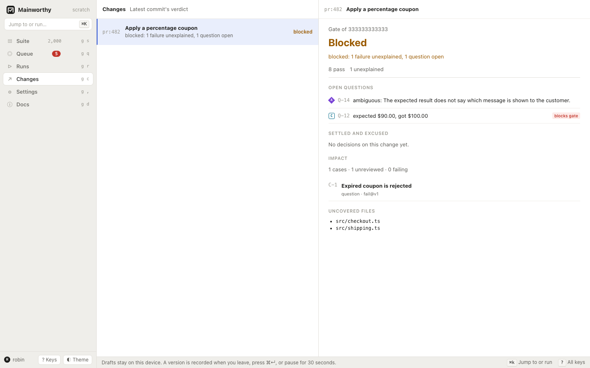

# Changes and the gate

Read a change's latest verdict and find what prevents it from passing.
Use the same gate from the command line to decide whether CI can continue.



## Open a change

To inspect a change's verdict, follow these steps.

1. Press <kbd>g</kbd> <kbd>c</kbd> to open Changes.
2. Select a change from the list.
3. Read its verdict and reason.
4. Open a question that needs an answer.

Use <kbd>j</kbd> and <kbd>k</kbd> to move between changes.
<kbd>Enter</kbd> opens the first question shown for the selected change.
See [the keyboard guide](./keyboard.md) for navigation keys.

A report identifies the tested commit. Branch or pull request metadata groups
commits into a change. For example, `pr:482` identifies a pull request.
The change shows its head commit's gate. A commit gate names one commit.
An older report arriving late does not move the change back to an earlier commit.
A report can also carry the current head read from the code host, so a reset or force-push
can move the change back. That head's gate stays pending until it has counted evidence.
See [report results](./report-results.md#follow-a-branch-reset) for `--head` and `target.head`.

A commit first reported by hash alone gains its scope when a pipeline or person later
names its branch or pull request, unless someone has typed a result for that commit.
Typed results keep their scope, question ids and answers. Otherwise, former answers
stay in the ledger as outdated and failures are evaluated in the named scope.
Every environment shares the same commit gate.

The list says "Latest commit's verdict". The detail shows the gate's reason and
nonzero counts, followed by "Open questions", "Settled and excused", and "Results".
Once impact loads, "Impact" and "Uncovered files" show the related cases and paths,
or say that there are none.
Impact lists related cases and review information. It is not a code coverage measurement.

## Read the results behind the verdict

"Results" lists every test the latest commit's gate counted, linked to a case or tracked
without one. Each row says how the gate counted the test and names who reported it.
It also shows the file, job, duration, and failure message when present, and the attempt
number after the first attempt. The test's name opens [the test's page](./report-results.md#read-what-each-test-did).
A row links to its case and failure question when available.
It also links to the CI build when the report supplied an HTTP or HTTPS URL.

Each result row uses one of the following labels.

| The row says | The gate counts it as | Why |
| --- | --- | --- |
| unexplained | `unexplained` | It failed and nobody has said why. Its question blocks the gate. |
| needs a fix | `attributed` | It failed and a decision says the change must be fixed. |
| excused | `excused` | It failed and a decision says it does not block, for example flaky. "quarantined" when a quarantine excuses it. |
| could not run | `missing` | The runner reported it blocked. |
| skipped | `skipped` | The runner chose not to run it. It proves nothing. |
| passed | `pass` | It passed. |

Failures come first. To filter by how the gate counts tests, choose a count or a
button above the list. To find a test by name or file, type in the filter.
The rows add up to the counts. Results from different producers, jobs, or environments
have separate rows, even for the same test. A retried test shows the attempt the gate counts.

The command line and the API return the same rows. For example, these commands
list results for a change or unexplained results for a commit:

```sh
$ mainworthy find --in results --change pr:482
$ mainworthy find --in results --commit 1111111111111111111111111111111111111111 --state unexplained
```

`--state` takes the words in the second column. `--unlinked` keeps the tests with no
case and `--text` filters by name or file. The reply's `tally` counts every row, whatever
the filter. Pass the reply's `cursor`, with the same filter, to read the next page. A new
result, decision, or case link can change which rows match or how the gate counts them.
If the filtered list changes, the server refuses its earlier cursor with `conflict`.
Read again from the first page. The web UI then offers "Read the results again".
A planned run's results are its slots: `mainworthy find --in slots --run R-2`.

The diagram follows the default policy, which requires counted evidence. A project can separately allow an explicit [CI declaration that no tests are required](./policy.md#reports-with-no-tests).

[Diagram: how a gate reaches its verdict](../diagrams/gate-verdict.html)

## Follow a change from push to push

Each commit a report names on a change gets a change run of its own. Under "Results", "Runs, newest
first" lists the change's runs: the commit, the verdict, its reason and how long ago the run was made.
Choose a row to open that run in Runs, with every result its gate counted. "More runs" reads the next hundred.

From the command line:

```sh
$ mainworthy find --in runs --change pr:482
```

## Act on the verdict

`passed` means counted evidence exists, or the project's policy accepts an applied CI declaration that no tests are required.
No current failure, dispute, missing requirement, or blocking question prevents
passage. Read "Settled and excused" to see whether a decision excused a failure.
Read "Results" to see each test. Passed does not mean every test passed.

`failed` means a decision attributes a failure to the target.
Fix the product, fix the test, or update the case and test for an intended change.
Then report the new evidence. If the judgment was wrong, withdraw or replace it.

`blocked` means an unexplained failure, a dispute, or an open blocking question
needs a decision. Open the question, read its evidence, and [answer it](./decide.md).
Re-running alone is not a substitute for explaining a failure that still counts.

`pending` means the gate cannot give a completed verdict yet.
Report missing evidence, wait for an accepted upload to be applied, or renew an
expired decision. A run with only skipped results has proven nothing and stays pending.
A planned run can also wait for a required job or an unfilled slot.
A commit whose job reports in shards waits for every shard of that job.
See [report from sharded jobs](./report-results.md#report-from-sharded-jobs).

An unexplained failure can make a run blocked even when it also has missing results.
The reason names the condition that currently determines the verdict.
See [runs](./runs.md) for planned-run requirements.

A quarantined automated test keeps its failures in the run and history. The gate's
reason says how many quarantined failures were recorded and are not blocking,
including when other evidence keeps the gate blocked or pending. The `quarantined`
field gives that count when nonzero. A passing verdict with quarantined failures
therefore does not claim those tests passed. See
[quarantine an unreliable test](./report-results.md#quarantine-an-unreliable-test).

## Read the gate in CI or a shell

```sh
$ mainworthy gate
$ mainworthy gate --commit 1111111111111111111111111111111111111111
$ mainworthy gate --change pr:482
$ mainworthy gate --run R-2
```

With no target flag, `gate` uses CI or Git detection.
Choose one commit, change, or run per call.
If a commit was reported for several repositories, use `--repo` to identify the one
whose gate you need. Mainworthy refuses to guess between repositories.

The verdict sets the exit code:

- `0` means `passed`.
- `1` means `failed`.
- `2` means `blocked`.
- `3` means `pending`.
- `4` means the command encountered an input, connection, or operation error.

Use `--wait <seconds>` to wait while the verdict is pending.
It does not wait for a person to answer a blocked question.
Use `--json` for structured output. [The CLI guide](./cli.md) lists every flag.

## When a change ends

A pull request ends when it is merged or closed without merging. To stop questions
about the change, report that the pull request ended:

```sh
$ mainworthy change --change pr:482 --state merged --compact
{"change":"pr:482","state":"merged","questions":["Q-115"],"already":false}
```

`--state` takes `merged`, `closed` or `open`. The reply lists the failure questions that were open
about the change and are no longer asked. Nobody will act on an answer about a pull request that has ended. A failure
introduced by the merge also appears on trunk and raises its own question there.

Include the exact commit that landed and its trunk branch:

```sh
$ mainworthy change --json '{"change":"pr:482","state":"merged","landing":{"commit":"1111111111111111111111111111111111111111","branch":"main"}}'
```

`landing.commit` sets the change's head, even if that commit is older than the recorded
head or CI has not reported it yet. Its gate is pending until results arrive. All its
environments belong to trunk, including environments reported later. Reports that
still name the pull request count for this head and raise unexplained failures on trunk.
The commit keeps its one gate, and planned runs that count it are recomputed.
Pull request answers remain attributable in history and still cover its older commits.
They do not carry to trunk. A landed commit's automatic inherited answer ends because the commit no longer
belongs to the change's base comparison.
Existing trunk answers apply. If this commit gate is the
newest run in trunk, its unexplained failures raise trunk questions immediately, even
before another report arrives. An older gate can remain blocked without an open
question. Planned runs that count the commit still ask about their unexplained failures.

Archives keep the resulting target and run scopes but omit the history of scope moves.
To transfer older data, upgrade the source database and export it again as described
in [data](./data.md).

A different merge or rebased hash leaves the original commit in its existing scope.
Omitting `landing` ends the change and keeps its recorded head. You can supply the
landing later by repeating `merged` with the metadata.
`landing.branch` takes `main`, `master` or `trunk`. Reopening a change does not move a
commit back from trunk.

A merged change keeps its recorded head. Neither an ordinary report for another commit
nor a report with `target.head` can replace it. Without landing metadata, the head stays
on the commit recorded when the change ended. Reports still count evidence, so late
results for that head can change its verdict. A landing sent later selects its commit
as the head and places it on trunk.

A change closed without merging continues to follow reports and code-host head
observations. Explicitly reopening a merged change lets it follow reports again.
A landed commit keeps its trunk scope.

The following records remain after a change ends.

- The merged change's head. Its row and `gate --change` keep showing that commit's gate.
  Without new landing metadata or evidence, an unexplained failure still reads
  `blocked`, with no open question behind it.
- Answers already given. They stay under "Settled and excused".
- Findings about the change. A finding is about a case, and is still worth an answer.
- A question that an open planned run shows unexplained. That run waits for the answer
  whatever became of the change.

A report that arrives after the end, from a job that finished late, is recorded and counted.
It raises no question in the ended scope. A landed head is now on trunk, so its late
failures are evaluated and asked about there.

When a pull request reopens, report the new state. Unexplained failures on its
newest commit raise questions at once:

```sh
$ mainworthy change --change pr:482 --state open
```

A pipeline or a person says how a change ended. Mainworthy refuses an agent's report
of a change ending or of a commit's scope. In Changes, an ended change is marked "merged" or
"closed". See [report results](./report-results.md#say-when-a-pull-request-ends) for the
workflow that sends this from GitHub Actions.

## Distinguish uploads from gates

A successful report records evidence and prints a receipt.
Its exit code does not decide whether the commit passes.
Call `mainworthy gate` after `mainworthy report` in your pipeline.
See [report results](./report-results.md#add-github-actions-reporting).

A test can gate a commit even when it has no case.
An invalid automated case annotation does not discard a failing outcome.
A newer decisive attempt can replace the previous result from the same producer,
job, target, and test. A pass from a different job cannot clear that failure.

## Understand agent evidence

A commit reported only by an agent has no counted commit gate.
Reading its gate returns pending with nothing proven.
An agent's results are recorded and visible, and failures can raise questions.
Those results do not move the change's counted head or its commit verdict.

Agent results count only in a planned run that asks for agents on a case that
admits them. A review is still not a runtime pass. See [agents](./agents.md).

## Change a verdict with a decision

Answering a failure recomputes the gates that show that cause.
Choose "Infrastructure" to excuse the target you are looking at, or "Flaky" to
excuse it while the hold lasts. The gate can then pass without another upload
if it has no other outstanding condition.

Choose "Defect in the product", "The test is wrong", or "Expected: behaviour changed"
to attribute the failure. The gate becomes failed until passing evidence replaces
that failure or the judgment changes.

The result stays recorded in either case. The decision changes what the failure
means for the gate. Withdrawing an excuse can block the gate again.
See [decide](./decide.md#explain-a-failure) for duration and later occurrences.

## Publish the gate as a GitHub commit status

The token's user needs push access to the repository. Use either a fine-grained
personal access token with **Commit statuses: write** permission or a classic
token with the `repo:status` scope. If you also send GitHub defect requests, a
fine-grained token needs **Issues: write** permission.

To enable status publication, follow these steps.

1. Create a token with the required permissions for the repository.
2. Store the token in the server's secret environment as `MAINWORTHY_GITHUB_TOKEN`.
3. Set the following server variables:

   ```sh
   MAINWORTHY_GITHUB_PROJECT=scratch
   MAINWORTHY_GITHUB_REPOSITORY=example/shop
   MAINWORTHY_PUBLIC_URL=https://mainworthy.example
   MAINWORTHY_GITHUB_STATUSES=1
   ```

4. Restart the server.
5. Report results with that repository and the full, lowercase, forty-character commit hash.

See [configuration](./configuration.md) for the shared GitHub variables.

A report from a pipeline or a person enrolls the commit. Reports accepted before
publication was enabled are not enrolled. Agent-only reports do not enroll a commit.

On the pull request, look for `mainworthy/gate` among the status checks. It shows the gate's reason, shortened to 140 characters, and links to the change on the instance. A trunk commit links to its run. GitHub shows success for `passed`, failure for `failed`, error for `blocked`, and pending for `pending`.

Later decisions, withdrawals, reports, and expired holds post a newer status in the same context without rerunning CI. GitHub displays the latest status for that context. A commit gets at most one publication attempt per minute. Intermediate changes combine into the latest verdict. Unchanged accepted
content sends nothing. The job handles up to twenty commits per run. Shared rolling limits allow
twenty posts per minute and 240 per hour. Failed and uncertain attempts count toward both limits.

If GitHub refuses a post, is unreachable, or its reply is lost, Mainworthy retries the current gate with exponential back-off. The delay starts at one minute, doubles after each unsuccessful attempt, and stops growing at one hour. After sixteen consecutive failed or uncertain attempts, that commit stops delivery with one fixed diagnostic. A new counted report resumes it, subject to any existing delay. Check connectivity, repository access, and Commit statuses write permission before reporting again. A successful post resets the attempt count.

An HTTP 429 pauses status posts for every commit, including newly enrolled commits. An HTTP 403 does so only when `x-ratelimit-remaining` is zero or `retry-after` is valid. Mainworthy waits for the longest of the exponential delay and applicable headers. It uses `x-ratelimit-reset` only with remaining zero or a valid `retry-after`.
Mainworthy caps each header-derived pause at one day. Repeated rate-limit replies increase the shared delay too, even across different commits. Other 403 replies, including missing permission, use the ordinary per-commit back-off, starting at one minute. The pause, attempt counts, and rolling limits survive a restart. No response body or exception text is stored or logged. GitHub allows 1,000 statuses per commit and context, so repeated changes or uncertain retries can eventually exhaust that limit.

After thirty days without a gate-payload change or a new counted report, an accepted commit stops automatic reconciliation. GitHub keeps its last status. Later decisions on that commit publish only after another counted report resumes reconciliation. Failed deliveries stop after the sixteen-attempt bound, even if the gate changes. Decisions alone do not resume a stopped commit.

Status delivery, shared limits, and enrollment are excluded from archives. Imported history does not publish statuses until a new counted report enrolls a commit. The token stays in process configuration.

The published status is separate from the workflow step that ran `mainworthy gate`. A later decision can make `mainworthy/gate` green while that earlier step stays red. Choose required status checks accordingly, and keep runner setup failures and missing reports as CI failures.
