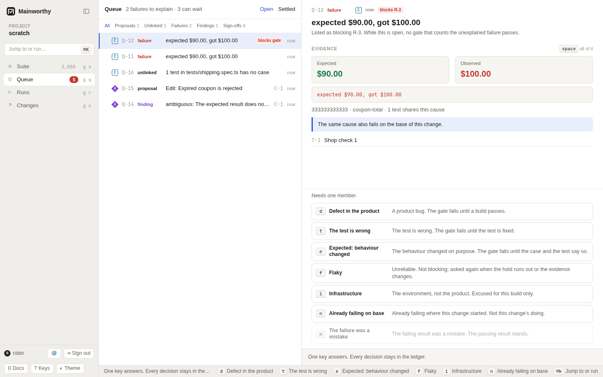

# Decide in the queue

Read the evidence behind a question and record an answer with one key.
Use the answer's stated consequence to decide what the gate needs next.

## Find the question to answer

1. Press <kbd>g</kbd> <kbd>q</kbd> to open Queue.
2. Select a question.
3. Read its evidence and the text beside each available answer.
4. Press the answer key.

Use <kbd>j</kbd> and <kbd>k</kbd> to move between questions.
Press <kbd>Space</kbd> to expand the evidence.
The "Open" view contains questions that need an answer. "Settled" contains decisions.
You can filter by "Proposals", "Unlinked", "Failures", "Findings", or "Sign-offs".
See [the keyboard guide](./keyboard.md) for the full key list.

## Know what needs you today

The line beside "Queue" splits the open questions in two, for example
"1 failure to explain · 104 can wait". Start with the failures. They are listed first,
and the count beside Queue in the sidebar is red only while one is open.

A failure is the one kind of question that blocks anything. While nobody has explained a
failure, no gate that counts it passes. An earlier occurrence of the same cause that someone
answered for another build stays excused there. Every other kind leaves things as they are until
someone answers: a proposed edit waits, a finding stays on record, and a test with no case
still runs and still gates the build.

Under its title, each open question says what leaving it costs. For example:

- "Listed as blocking R-83. While this is open, no gate that counts the unexplained failure passes."
- "Blocks nothing. Left alone, these tests still run and still gate the build, and no case gets credit for them."

The runs a failure lists are the ones it was listed under as its results arrived. Open a
run to read its gate as it is now: an older commit's run can pass again while a newer
commit keeps the question open.

A failure stops blocking a gate in two ways. Someone answers the question. Or the failing
result is replaced. A newer attempt of the same job that passes replaces it; an attempt
that is skipped or blocked leaves the failure in place. A result that names
the failing one as the result it corrects replaces it whatever its outcome: passed, skipped
or blocked. A pass reported beside the failure replaces nothing. The two disagree, and a
person settles that.
A pull request's gate is the gate of its newest commit, so a newer commit that passes moves
the pull request on. The older commit keeps the verdict it had.

A failure that only an agent reported, or one typed for a session, is counted by no commit's
gate. It is still a failure to explain.

A question asks for a judgment about recorded evidence. It is not a test result.
Several occurrences of the same failure cause can share one question.
Look for "blocks gate" and the runs named beside the question.

[Diagram: the life of a question](../diagrams/question-lifecycle.html)

## Choose an answer

Only answers that apply to the current evidence are available.
For example, "The failure was a mistake" applies to a disputed planned-run result.
"Already failing on base" is available for a change, not a trunk failure.

<!-- generated:answer-keys -->

### A proposed edit (`adopt`)

| Key | Answer | What it does |
| --- | --- | --- |
| <kbd>a</kbd> | Accept | Makes this the current version. |
| <kbd>r</kbd> | Reject | Leaves the case as it is. The proposal stays in the history. |
|  | Merge | Adopts the version you put together from both sides. |

### A test with no case (`map`)

| Key | Answer | What it does |
| --- | --- | --- |
| <kbd>l</kbd> | Link to a case | Results of this test count for the case from now on. |
| <kbd>c</kbd> | Create cases | Makes one case per test and links them. |
| <kbd>t</kbd> | Track without a case | Keeps them as tests without cases. They still gate the build. |
|  | Unlink | The test stops counting for its case. |

### A failed result (`failure`)

| Key | Answer | What it does |
| --- | --- | --- |
| <kbd>d</kbd> | Defect in the product | A product bug. The gate fails until a build passes. |
| <kbd>t</kbd> | The test is wrong | The test is wrong. The gate fails until the test is fixed. |
| <kbd>e</kbd> | Expected: behaviour changed | The behaviour changed on purpose. The gate fails until the case and the test say so. |
| <kbd>f</kbd> | Flaky | Unreliable. Not blocking; asked again when the hold runs out or the evidence changes. |
| <kbd>i</kbd> | Infrastructure | The environment, not the product. Excused for this build only. |
| <kbd>n</kbd> | Already failing on base | Already failing where this change started. Not this change's doing. |
| <kbd>m</kbd> | The failure was a mistake | The failing result was a mistake. The passing result stands. |

### A finding from a review (`finding`)

| Key | Answer | What it does |
| --- | --- | --- |
| <kbd>a</kbd> | Accept | Agree. A suggestion it carries becomes a proposed edit by its author. |
| <kbd>r</kbd> | Reject | Disagree. It is not raised again for this version. |
| <kbd>d</kbd> | Duplicate | Already covered by another finding. |
| <kbd>z</kbd> | Defer | Not now. It stays on record. |

### Closing a run (`signoff`)

| Key | Answer | What it does |
| --- | --- | --- |
| <kbd>a</kbd> | Approve | Closes the run with the verdict it has now. |
| <kbd>r</kbd> | Reject | Leaves the run open. |

<!-- /generated -->

A key records the answer immediately unless the answer needs another field.
"Link to a case" opens a case picker for each test. "Defect in the product" lets you
enter an optional defect reference. If the policy requires a reason, enter it before
submitting. The queue keeps unfinished reference and reason text on this device.

If evidence changes while you answer, Mainworthy refuses the stale answer.
Read the new evidence before trying again. A decision names the evidence you saw.

## Review a proposal

An adoption question asks whether a proposed edit becomes current.
Read the proposed changes beside the existing case.
"Accept" makes the proposal current. "Reject" leaves the case as it is and keeps
the proposal in history. These choices do not by themselves excuse a test failure.

An edit conflict needs a merged body, rather than a plain acceptance.
Resolve it in the case's conflict card. See [write cases](./write-cases.md#resolve-simultaneous-edits).
The merged body is another proposal and still follows the adoption policy.

## Give an unlinked test a home

An unlinked-test question asks how to keep a test that has no case. A project asks it when its policy says "Ask in the queue" for tests with no case. Otherwise a rule tracks the tests or makes their cases, and you find its answers under "Settled". A rule leaves a file's question open in two cases: a person took the rule's answer back or answered against it, or, under `standard` with "Create a case for each test", an agent reported the tests and its new cases wait for a person. See [policy](./policy.md#tests-with-no-case).
"Link to a case" makes future results count for the chosen case.
"Create cases" creates one case per test and links each test to its case.
It works where the policy adopts your new case by rule: under `loose`, and for a person
under `standard`. Where a person must adopt a new case, under `strict` or for an agent
under `standard`, the answer is refused. Propose the cases, have them adopted, then
answer with "Link to a case".
"Track without a case" keeps the test without a case. The test still gates the build.

To give every file the same answer, change the project's choice instead of answering each row.
In Settings, Policy, choose "Track without a case" or "Create a case for each test" under
"Tests with no case". The rule then answers every open question about a file at once.

A link holds for the tests it names. A test that turns up later in the same file is a new
question, and the earlier links stay. "Track without a case" is about the file as it was:
the file is asked about again when its tests with no case change.

These choices settle the mapping question. They do not turn a failed result into a pass.
An already recorded result keeps its original basis. Link decisions affect later results.
See [report results](./report-results.md#link-tests-to-cases).

## Explain a failure

Choose "Defect in the product" when the product needs a fix.
Choose "The test is wrong" when the test needs a fix.
Choose "Expected: behaviour changed" when the intended behavior changed.
All three attribute the failure to the target and make its gate `failed`.
An expected change still needs the case and test to agree with that change.

These answers carry to later occurrences of the same cause in the same scope
while their basis holds. They have no fixed expiry date.
Withdraw or replace the answer when the judgment no longer applies.

Choose "Flaky" for an unreliable failure. The outcome stays recorded but is excused.
With the supplied presets, that answer carries for 14 days or until its basis changes.
When the hold ends, Mainworthy asks again if the failure still needs a decision.
The project can change the number of days. See [policy](./policy.md).

Choose "Infrastructure" for a failure in the environment.
It excuses the build you are answering about, including its specific environment,
rather than later commits or another environment of that commit.

Choose "Already failing on base" when the same cause already failed where the change
started. It excuses this target only. The next commit is judged separately.
The evidence can show a hint that the same cause fails on the base.

For a disputed slot, "The failure was a mistake" excuses the named failing results
so the passing result can stand. It does not excuse a new failure reported later.
See [runs](./runs.md#resolve-a-disputed-slot).

An excuse removes that failure's block. The gate passes only if nothing else prevents
it. Missing results, other failures, and disputes still need attention.

## Judge a finding

A finding asks whether you agree with an observation, often from an agent.
"Accept" agrees with it. In the web queue, a suggestion it carries becomes a proposed
edit by the finder. That edit follows the normal adoption policy.
"Reject" records disagreement. "Duplicate" records that another finding covers it.
"Defer" records that you are leaving it for later.

These answers stay with the finding's basis, including its case version and change.
They do not convert a review into a runtime pass or directly change a commit's gate.
A changed patch under the same pull request does not yet invalidate a review by itself.
See [agents](./agents.md) for the distinction between reviews and test results.

## Close a completed run

A sign-off question asks whether to close a planned run that passes.
"Approve" closes it with its current verdict. "Reject" leaves it open.
Approval is refused if the run no longer passes when the answer arrives.
Under `loose` and `standard`, a recorded rule normally approves a passed run.
Under `strict`, a person supplies the answer and a reason.
See [runs](./runs.md#close-and-reopen-a-run).

## Undo or withdraw an answer

Press <kbd>u</kbd> to withdraw your latest answer, or open "Settled", select a decision,
and use its withdrawal button. Your authority still depends on the current policy.
The original decision and its withdrawal both stay in the record.

Withdrawing an excuse recomputes gates that depended on it. A failure can become
unexplained again. Withdrawing a link removes that decision's link unless a newer
link has replaced it. Withdrawing an approval reopens its run.

An adopted proposal cannot be withdrawn. Restore earlier case content as a new
version instead. See [write cases](./write-cases.md#read-versions-and-restore-earlier-content).
Withdrawing an older decision does not undo standing work made by a newer decision.

## Check who may answer

The question says whom it needs. Your token's capabilities and the project's policy
both matter. An agent's answer can count, remain advice, or be refused.
A pipeline cannot answer. Some failure decisions require a person who did not
produce the evidence. Read [policy](./policy.md) before changing those rules.
