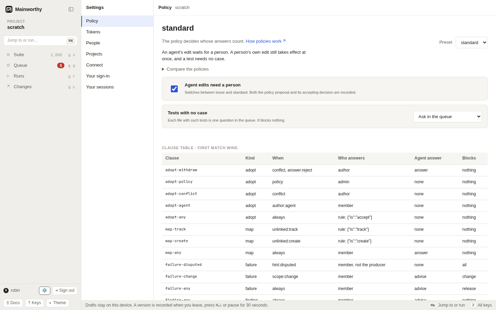

# Policy

Decide how strict a project is, read its policy, and switch it. A policy says who must answer each kind of question and what an agent's answer is worth.



## What a policy is

A policy is a table of clauses. Each clause covers one kind of question: a proposed edit, a test with no case, a failed result, a finding, or closing a run. For that kind it says who answers, whether they give a reason, and what an agent's answer is worth. Mainworthy reads the clauses of a kind from the top and uses the first one that matches.

[Diagram: who answers a question under a policy](../diagrams/policy-routing.html)

The `when` column holds the conditions a clause tests. `always` matches every question of its kind. The others describe the question: `author:agent` for an edit by an agent, `conflict` for an edit that clashes with a newer version, `policy` for a change to the policy itself, `scope:change` for a failure on a change, `hint:disputed` for two reports that disagree, and `verdict:passed` for a run that passed. `answer:reject` matches only once someone picks that answer. `unlinked:track` and `unlinked:create` test the project's choice for [tests with no case](#tests-with-no-case).

"Who answers" is one of these.

- A rule. Nobody is asked. The policy gives its answer at once and records it as a decision. A person with the `answer` capability can still overrule it.
- A member. A person with the `answer` capability.
- An admin. A person with the `admin` capability.
- The author. The person who wrote the proposal, or an admin.

An agent's answer is one of three things. It counts as a decision, it is shown as advice and a person decides, or it is refused. The table also says whether a person who produced the evidence may answer, and whether the answer needs a reason.

A failure that nobody has explained blocks every run that shows it, under all three presets. The policy decides who may explain it. The `blocks` column only says which runs list a question. A separate setting says whether an explicit CI declaration that no tests are required may pass an empty commit gate.

## Read the policy

In Settings, open Policy (<kbd>g</kbd> <kbd>,</kbd>). It shows the preset in force, a short summary, and "Compare the policies". An instance admin also sees the clause table, its settings, and "Edit clauses".

From the command line:

```
$ mainworthy policy show
policy: loose
kind     when                      who answers  agent's answer  blocks   rule's answer
adopt    conflict & answer:reject  author       counts          nothing
adopt    policy                    admin        refused         nothing
adopt    always                    rule         refused         nothing  {"is":"accept"}
map      unlinked:track            rule         refused         nothing  {"is":"track"}
map      unlinked:create           rule         refused         nothing  {"is":"create"}
map      always                    member       counts          nothing
failure  scope:change              member       advice          change
failure  always                    member       advice          release
signoff  verdict:passed            rule         refused         nothing  {"is":"approve"}
basis: exact-or-assumed; flaky hold: 14 days; tests with no case: track; empty reports: pending
```

The last line holds the settings. The basis is which evidence a planned run accepts for a slot by default, and `strict` raises it to `exact`. The flaky hold is how many days a "Flaky" answer carries forward. The other settings describe tests with no case and empty reports.

## Custom fields

An instance admin can define a project's fields in **Settings**, **Policy**, under **Custom fields**. Add a field, give it a key and label, choose **Text** or **Choice**, and mark **Required** if it needs a value. For a choice, enter one allowed value per line. Keys must be unique. Choices must be nonblank, unique, and fit on one line.

Press **Save field definitions** to propose and accept the change. Both the proposal and the admin's decision stay in the record. Definitions belong to the project and survive a switch of preset. If another edit changes the definitions while you type, **Reload field definitions** replaces your unsaved form with the current definitions before you can save.

Field values remain strings in a case's `fields` map. A required value cannot be missing or blank. A nonblank choice value must match an allowed value exactly. An optional field can be absent or blank. Keys without definitions remain free text. Removing a definition leaves all its values in place.

Definitions constrain new content when it is proposed and when it is adopted, including Markdown edits, restores, and merged edits. Changing a definition does not rewrite existing versions. An existing case with an invalid value stays readable, but its next content edit must supply valid values. A pending proposal that no longer meets the definitions is refused at adoption; reject it and propose valid content again.

Required fields cannot be combined with **Create a case for each test**. Automatic creation has no values for those fields. Choose **Ask in the queue** or **Track without a case** first. Optional definitions work with automatic creation.

The case editor does not edit field values yet. Use canonical Markdown or a `propose` body:

```
$ mainworthy propose --json '{"edits":[{"op":"edit","case":"C-1","base":1,"body":{"fields":{"risk":"high","legacy":"keep this value"}}}]}'
```

A supplied `fields` map replaces that map. Include every value you want to keep; omitting `fields` preserves the base version's values. Use `mainworthy get --json '{"refs":["C-1"],"as":"md"}'` to read them. The ordinary JSON case reply omits custom field values.

To define fields through the CLI or HTTP API, start with `mainworthy policy show --json`. Keep its settings and add a `fields` map, then propose the whole settings object:

```
$ mainworthy propose --json '{"edits":[{"op":"policy","settings":{"unlinked":"track","emptyReports":"pending","basis":"exact-or-assumed","holds":{"flakyDays":14,"infraThisTargetOnly":true},"fields":{"risk":{"kind":"choice","label":"Risk","required":true,"choices":["low","high"]},"notes":{"kind":"text","label":"Notes","required":false}}}}]}'
```

An admin who is a person accepts the resulting question in Queue or with `decide`. Sending the whole settings object without `fields` removes all definitions. The MCP tool listing omits field definitions to keep its token limit; use the CLI, HTTP API, or Settings for definition changes. Archives include the policy versions, values, proposals, and decisions.

## The three presets

`loose` is the default. Edits take effect at once, a test needs no case, and a person answers failures and findings. A run that passed closes by itself.

`standard` holds an agent's edit for a person. A person's own edit still takes effect at once, and a test needs no case. Two reports that disagree go to a person who did not produce either one.

`strict` asks a person for every edit, test with no case, failure, finding and passed run, and the person gives a reason. No agent answers any of them. Approval by a named role or by two people is not built yet, so `strict` is as far as the product goes today.

All three send a change to the policy to an admin, and send a conflicting edit back to its author. The presets differ most in what they ask of people, so this table, built from the presets themselves, shows who answers each question.

<!-- generated:policy-presets -->

| Preset | In short |
| --- | --- |
| `loose` | Edits to cases take effect at once and a test needs no case. A person is asked about failures and findings, and a run that passed closes by itself. |
| `standard` | An agent's edit waits for a person. A person's own edit still takes effect at once, and a test needs no case. |
| `strict` | A person, never an agent, answers every edit, test with no case, failure, finding and passed run, and gives a reason. The project can have its tests with no case tracked instead. A policy change and a conflicting edit are handled as under the other presets. Approval by a named role or by two people is not built yet. |

Who answers each question:

| Question | `loose` | `standard` | `strict` |
| --- | --- | --- | --- |
| A person's edit to a case | By rule: Accept | By rule: Accept | A person, with a reason |
| An agent's edit to a case | By rule: Accept | A person | A person, with a reason |
| A test with no case | By rule: Track without a case | By rule: Track without a case | A person, with a reason |
| A failed result | A person; agents advise | A person; agents advise | A person who did not report it, with a reason |
| A result that two reports disagree on | A person; agents advise | A person who did not report it | A person who did not report it, with a reason |
| A finding | A person; agents advise. Duplicate: a person or an agent | A person; agents advise | A person, with a reason |
| Closing a run that passed | By rule: Approve | By rule: Approve | A person, with a reason |
| An edit that conflicts with a newer version | Its author if a person, or an admin. Reject: its author (person or agent), or an admin | Its author if a person, or an admin. Reject: its author (person or agent), or an admin | Its author if a person, or an admin. Reject: its author (person or agent), or an admin |
| A change to the policy | An admin, not an agent | An admin, not an agent | An admin, not an agent |
| How long a `flaky` answer carries forward | 14 days | 14 days | 14 days |
| What fills a slot of a planned run | Also a result assumed to be for the current version | Also a result assumed to be for the current version | Only a result that names the pinned version |
| An empty report | `pending` | `pending` | `pending` |

<!-- /generated -->

## Tests with no case

A pipeline reports tests that no case names. What happens to them is one choice for the whole project, apart from the preset.

| Choice | What happens |
| --- | --- |
| Track without a case (`track`) | The tests are kept without cases and nobody is asked. They still gate the build. `loose` and `standard` start here. |
| Create a case for each test (`create`) | Each test gets a case named after it, in a folder named after its file's directory, and is linked to it. Nobody is asked. |
| Ask in the queue (`ask`) | Each file with such tests is one question in the queue. It blocks nothing. `strict` starts here. |

In Settings, open Policy and choose under "Tests with no case". From the command line:

```
$ mainworthy policy tests create
tests with no case: create; proposal P-3 and decision 4 are both recorded; 12 open questions answered by the rule
```

The change is a proposal and a decision like any policy change, so it needs `produce` and `admin` on the project. It takes effect for the questions that are already open: the rule answers every open question about a file at once, and the line above says how many. A question that a person took back from the rule stays with people.

`create` makes cases the way a person's edit does, so it works where the policy adopts a pipeline's new case by rule. `strict` has a person adopt every new case, and refuses `create`:

```
invalid: under this policy a person adopts every new case, so a rule cannot create cases for tests: choose ask or track
```

Under `create`, anyone who can report results can add cases, one for each test name they send. A report still cannot change or remove a case. Under `standard` an agent's report is the exception: an agent's new case waits for a person, so the rule makes none and the file's question stays open.

A link holds for the tests it names. When another test turns up in the same file, only the new test is asked about or given a case. A "track" answer is about the file as it was, so the file is looked at again when its tests with no case change. Under `track` the rule answers again and you see nothing.

A custom policy reads the choice only if its clauses test `unlinked:track` or `unlinked:create`. Settings offers the choice under a preset.

## Reports with no tests

Every preset starts with `emptyReports: "pending"`. A commit without counted evidence stays pending, even when CI says no tests are required.

For a pipeline that legitimately runs no tests, such as a docs-only change, an admin can enable an explicit declaration:

```sh
$ mainworthy policy empty nothing-required
empty reports: nothing-required; proposal P-4 and decision 5 are both recorded
```

This uses the same proposal and admin decision as other policy changes. It requires `produce` and `admin` on the project. Settings has no control for this setting. To restore the default, run `mainworthy policy empty pending`. Choosing any preset also restores `pending`.

With the setting enabled, a CI actor sends `mainworthy report --nothing-required`, with the tested commit supplied or detected. The declaration stays in the report record. A human or agent token cannot send it. An empty JUnit file alone is not a declaration.

The exception passes only a commit gate with an applied declaration and no ordinary reports for that commit and repository. A skipped, blocked, refused, or agent-only report prevents the exception, in any job or environment. An empty declaration cannot hide an existing failure. It never fills a planned run's case slot or required job. Missing reports stay pending.

The setting applies to recorded declarations too. Disabling it returns an otherwise empty gate to pending. An upload receipt remains the verdict at upload time. Use `mainworthy gate` to read the current verdict.

The API policy edit is `{"op":"policy","emptyReports":"nothing-required"}`. The report is `{"target":{"commit":"1111111111111111111111111111111111111111"},"results":[],"nothingRequired":true}`.

## Switch the policy

1. Open Settings, then Policy.
2. Choose a preset in "Preset".

The switch "Agent edits need a person" is a shortcut. It flips between `loose` and `standard`. It is hidden while the policy is `custom`.

From the command line:

```
$ mainworthy policy use standard
policy: standard; proposal P-1 and decision 1 are both recorded
```

You hold the right to switch when you have `produce`, to propose, and `admin` on the project, to accept. A switch is a proposal, and accepting it is a decision. Both stay in the record, and you can find them in Queue under "Settled". No agent can accept one, whatever its grant says.

If you cannot accept it yourself, the proposal stays open for an admin:

```
$ mainworthy policy use strict
policy proposal P-2: open Q-2 needs an admin
```

An admin finds it in Queue under "Proposals". Reading the clause table needs `admin` on every project, which is more than switching needs.

A policy change rewrites nothing that is recorded. Results, decisions and cases stay as they were. What changes is who may answer, whether a reason is needed, and whether an empty declaration passes. That holds for the next question and for every question that is still open: an open question now waits for whoever the new policy names. One kind of question is answered at the change: where the new policy has a rule for [tests with no case](#tests-with-no-case), the rule answers the open questions about them, and under `create` that makes their cases.

## Change single clauses

In Settings, open Policy and choose "Edit clauses". This needs a person with instance `admin`, to read the full policy, and `produce` on the project. A project admin can still use the existing preset and tests-with-no-case controls.

1. Edit the clause's conditions, who may answer, agent permissions, reason requirement, producer restriction, or which runs list it. Write conditions one per line. For a rule, write its answer as JSON, for example `{"is":"accept"}`.
2. Add, remove, or move clauses with the row controls. The first matching clause wins. Each kind must end with a clause whose only condition is `always`.
3. Set the flaky hold, evidence basis, and infrastructure hold below the table. The draft keeps the current choice for tests with no case.
4. Choose "Preview recent questions" to compare the draft with the policy in force when you opened the editor. The sample contains up to 20 open questions in queue order and 20 most recently settled questions. Each question shows matching for its current facts and its applicable answer choices.
5. Give a policy change reason, then choose "Apply policy". Mainworthy records the proposal and its accepting decision through the same operations as a preset switch.

Invalid conditions, duplicate clause ids, invalid rule answers, missing final `always` clauses, and holds outside 1 to 365 days prevent preview and apply. Preview reads questions without changing the policy or recording decisions. It shows clause matching, who may answer, rule answers, and which runs list the question. It does not replay decisions, check a particular person's permissions, execute rules, or predict a gate result. Existing decisions stay recorded. Hold and basis changes affect future decisions and runs.

A refused request keeps your draft in the open editor. If the policy changed while you edited, applying asks you to cancel and reopen from the current policy. Cancel discards the draft. Leaving Settings or reloading also discards it.

From the command line, send a policy edit to `mainworthy propose`. The edit carries the whole clause list, so start from what `mainworthy policy show --json` prints, change a clause, and send it back. This example, with the clauses cut to `[...]`, makes a reason mandatory for findings and shortens the flaky hold to 7 days:

```
$ mainworthy propose --json '{"edits":[{"op":"policy","preset":"standard","clauses":[...],"settings":{"unlinked":"track","emptyReports":"pending","basis":"exact-or-assumed","holds":{"flakyDays":7,"infraThisTargetOnly":true}}}]}'
{"proposal":"P-9","question":"Q-9","conflicts":[],"status":"open","needs":"an admin","cases":[]}
```

An admin accepts it like any policy change. Mainworthy refuses a policy in which some kind of question has no last clause that matches `always`:

```
invalid: every kind must end with a clause that always matches; missing for: finding
```

The settings are sent whole: `unlinked`, `emptyReports`, the basis, the holds, custom field definitions in `fields`, and `flakyDetection`.
Omitting `emptyReports` selects `pending`. Omitting `fields` clears the definitions. Omitting `flakyDetection` selects its defaults.
The flaky hold takes 1 to 365 days. `infraThisTargetOnly` is true when an "Infrastructure" answer covers only the build it was given for.

## Same-code detector settings

Settings, Policy shows the detector's current values below the clause table.
`mainworthy policy show --json` includes them in `settings.flakyDetection`.
Every preset starts with detection enabled, a 14-day window, and a threshold of
two outcome changes per test and failure signature. A file-split signature has its
own count, separate from the original cause.

To change them, start from the current settings and send a policy edit. Keep the
other settings as they are. This example uses the other defaults:

```json
{"edits":[{"op":"policy","settings":{"unlinked":"track","emptyReports":"pending","basis":"exact-or-assumed","holds":{"flakyDays":14,"infraThisTargetOnly":true},"flakyDetection":{"enabled":true,"windowDays":7,"minFlips":3}}}]}
```

Send it through `mainworthy propose --json` and have an admin accept the policy
question. `windowDays` accepts 1 to 365 days, and `minFlips` accepts 1 to 100.
`enabled: false` hides current detector suggestions without deleting observations.
Changing these values affects current test-detail reads and future failure-question
occurrences. Existing questions keep the snapshot recorded with their evidence.
Omitting `flakyDetection` from a whole-settings edit selects its defaults.

These settings control suggestions only. They do not change `holds.flakyDays`,
which controls how long a person's `flaky` answer carries forward. Infrastructure
and timeout observations have their own counts and never raise the assertion count.
See [report results](./report-results.md#preserve-attempts-and-retries) for what a flip counts.

## What custom means

A policy is `custom` when its clauses are not exactly those of a preset. A preset's name can stay on the stored policy after you edit its clauses, so Mainworthy compares the clauses and not the name. Settings and `mainworthy policy show` then say `custom`, the preset summary and the compare table's marked column go away, and the switch between two presets is hidden. Choosing a preset in "Preset", or `mainworthy policy use`, replaces every clause with that preset's.

## Choose a preset for a new project

Choose the first policy when you create a project. In Settings, open Projects and pick "Initial policy" under "Create a project". It defaults to `loose`. You can switch later without migrating anything.

- Start with `loose` when one person or a small trusted team writes the cases, and you want the queue to hold only failures.
- Use `standard` when agents propose edits and a person should read each one first.
- Use `strict` when each answer needs a person and a recorded reason, for example when someone else audits the queue.

Whether each test needs a case is a separate choice. Leave it at "Track without a case" when the cases describe what people check and the pipeline's tests stand beside them. Choose "Create a case for each test" when every test should appear in the suite. Choose "Ask in the queue" when someone links each file's tests by hand.

A policy belongs to one project. A team can run a `loose` scratch project and a `strict` release project on one instance.

## See also

- [People, agents and pipelines](./access.md) for who holds `answer` and `admin`.
- [Let an agent in](./agents.md#what-agent-work-is-worth) for what an agent's work is worth under each preset.
- [Decide in the queue](./decide.md) for answering a question.
