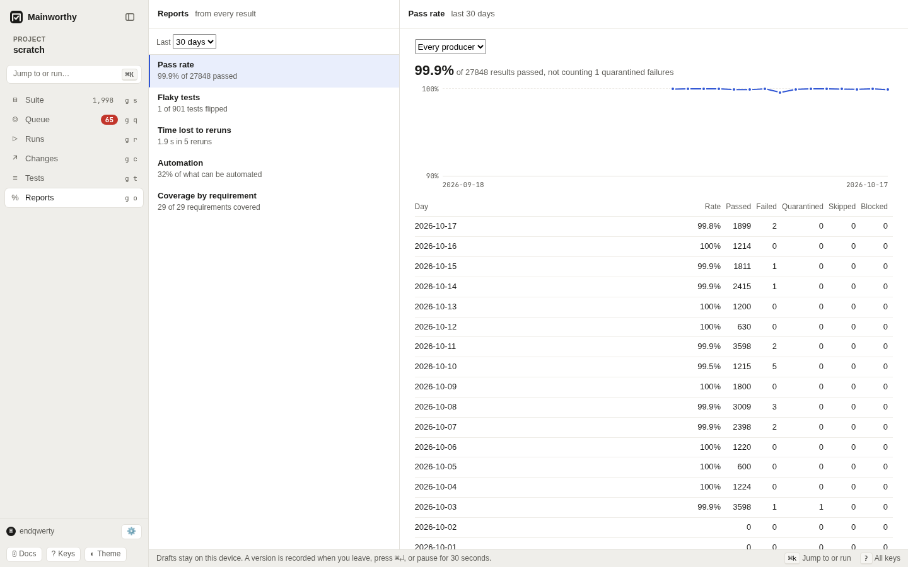

# Reports

Read what the results of the last days say: how often tests pass, which tests are flaky, how much time reruns
cost, how much of the suite is automated, and which requirements have cases that pass.
Every report reads the one stream of results, from people, pipelines and agents alike.

## Open a report

1. Press <kbd>g</kbd> <kbd>o</kbd> to open Reports.
2. Select a report from the list. Each row shows its headline number.
3. Choose how many days to read: 7, 14, 30 or 90. Pass rate reads calendar days, today included. The other
   reports read that many 24-hour periods back from now.

Use <kbd>j</kbd> and <kbd>k</kbd> to move between reports.
The day and producer dropdowns follow the site's light or dark theme.

From the command line, `mainworthy stats --of <report>` prints the same report as JSON, for example
`mainworthy stats --of flaky --days 14`. Over HTTP it is `POST /api/p/<project>/stats` (see [the API](./api.md#stats)).
Agents read reports this way too: `stats` is not one of the agent tools.

The flaky, rerun, manual effort and automation reports show 20 rows per page, and coverage shows 100. Each list says
"Showing N of M". The headline numbers count every row. Choose **Next page** or **Previous page**, or press
<kbd>n</kbd> or <kbd>p</kbd>, to reach the rest. On a phone, open **Actions** and choose **Next report page** or
**Previous report page**. Changing the day window starts at the first page. If live updates remove the page
you are reading, the list returns to the first page. If a page cannot be read, **Previous page** and <kbd>p</kbd>
still return to the preceding page.

The CLI accepts `--limit` (up to 200 rows, or 500 requirements for coverage) and `--cursor`. Over HTTP, use
`limit` and `cursor`. Each limited report reply
includes `total`, the number of rows before paging, and `cursor`, the next page or `null` at the end. Pass the
returned cursor with the same report and window to continue. Pages read current results; if the data changes
between reads, start from the first page to read the new order.

## Pass rate

The share of results that passed, per day, of those that passed or failed. Skipped and blocked results are counted
beside the rate and are not in it.

- Each test counts once for each job, producer and method on each target, by its latest attempt that passed or
  failed. A target is what was tested: a commit in one repository and environment, or a run with no commit. Two
  environments of one commit count apart.
  A later skip or blocked attempt does not replace a pass or a failure, and of two results for one attempt the worse
  counts. A failure that a rerun of the same job then passed counts as a pass, and the failed attempt is in
  [time lost to reruns](#time-lost-to-reruns). This is the rule a gate counts with.
- A result its producer corrected is replaced by the correction.
- A failure recorded while its test was in [quarantine](./report-results.md#quarantine-an-unreliable-test) is counted as
  quarantined, apart from the failures, and does not lower the rate. Quarantine that starts or ends later does not
  change how earlier results count.
- The days are the reader's. The web page uses your browser's time zone. The command line and the API use UTC
  unless you give `--zone` with a time zone's name, for example `--zone Europe/Berlin`. An offset such as `+05:30`
  is refused.
- Choose a producer to read only people's, pipelines' or agents' results (`--method human`, `auto` or `agent`).

## Flaky tests

A flaky test passed and failed on the same code: the same target (repository, commit and environment), job and
producer, one attempt after another.
Mainworthy records such a flip when the report arrives. A flip whose pass or failure its producer later corrected
is not counted. The report lists the automated tests with flips in the window, the most flips first, and says which
of them are in quarantine. The headline compares them with every automated test that reported in the window, whoever
reported it.

## Time lost to reruns

An attempt that a later attempt of the same test, job, commit and producer repeated is a rerun, counted once
however many times that attempt was reported. The report adds up the time those attempts took, as their reports said
it (of an attempt reported twice, the time of the result it counted: the worse, then the later), and lists the tests
that cost the most. A correction counts in place of the attempt it corrects, its time included, whichever attempt
the correction was sent with. Where older stored history has two corrections of the same result, the attempt
counts the worse of the corrections that stand, then the later. The report follows at most 64 correction links.
If any branch continues beyond that, the attempt contributes unknown time; durations and runner tries from
its unresolved prefix are not used. An unresolved attempt counts once, including when its final runner tries
cannot be read within the bound. Only corrections keeping the same project, test, producer, target and run count.

The runner's earlier tries inside an attempt also count as reruns, even if the pipeline ran only once. Each try
adds its reported duration. When a later pipeline attempt repeats the whole attempt, its reported duration counts
once, without adding known try durations again: Playwright already sums those durations. A try without a duration
always counts as unreported time, even if its attempt has a duration: Surefire times only one execution.
If the repeated attempt's duration is missing, the report keeps the known try durations. For an attempt not repeated,
only its earlier tries count; the final execution is not time lost. A correction replaces its result's tries too.

Each test's time and the report's total stop at 9,007,199,254,740,991 ms, JavaScript's largest safe integer.
Old or imported durations above today's input limit cannot overflow the report; a time at that ceiling means
at least that much was reported. Negative stored durations cannot make a test's time or the report's total
less than zero.

## Automation

A case is automated when an automated test is linked to it. The rate is the automated cases over the active cases
that can be automated: a case marked as one that cannot be automated is left out, unless a test covers it anyway.
The other cases are counted by what they say about automation: to automate, not decided, or cannot be automated.

The backlog lists the cases that can be automated and are not, the ones run by hand most often in the window
first. Where people recorded how long a run took, the time is shown too. Each case's total stops at
9,007,199,254,740,991 ms, including larger historical or restored durations. A reported zero is zero;
when no run reported a duration, the time stays unknown.

## Manual effort

Choose **Manual effort** to rank active cases by known manual time, greatest first. A few long executions
rank above many short ones when their known total is greater. Cases with linked automated tests stay in the
report while people still run them, marked **has automation**. Cases marked as unable to be automated also appear.
The Automation report keeps its rate and frequency backlog.

Each row shows the execution count, timed and untimed counts, known total, and average over timed executions.
A mixed total says **partial**. When no execution was timed, both time values say **Unknown**; a reported zero
stays zero. Unknown totals sort after known totals. Equal totals sort by execution count, then case number.
Totals and averages stop at JavaScript's largest safe integer, 9,007,199,254,740,991 ms.

The selected number of 24-hour periods and the exact start and end are shown. A correction replaces the
original execution's timing once, in its original period, even when the correction arrived later. For imported
history with competing corrections, the worse outcome wins, then the later result, as in the rerun report.
The report follows up to 64 correction links per execution. If any branch continues beyond that, the execution
still counts but its timing is unknown. Corrections from another project do not affect its timing.
The average describes only timed work; missing timings are never estimated.

Use `mainworthy stats --of manual-effort --days 30` for the same paginated report as JSON.

## Coverage by requirement

Each requirement with the active cases that cover it. The list shows 100 requirements per page, and the headline
counts all of them. A case counts by the latest result of each of its tests in
the window: failed when one of them failed, passed when none failed and one passed, skipped or blocked when that
is all they were, and not run when none of its tests has a result in the window. A requirement with no active case
is marked. A case covers a requirement through `covers: [KEY]` in its Markdown, or `@KEY` on the title line of a
capture outline.

Reports with new tests in more than 100 files finish asking about those files in background pages.
The first 100 files are handled with the report; the rest follow after its results have committed.
Each page uses the project's current policy, so **Create** cases and **Ask** questions may appear
shortly after the report receipt. A deferred question covers only tests in its originating report,
using that report's actor; tests from later reports keep their own adoption requirements. Interrupted pages retry without duplicating their decisions.

Deferred file mapping survives both project and instance export. After import, background jobs finish those pages under the restored policy. Archive version 45 includes pending pages; archives from earlier versions must be exported again with this version before importing.

Answering a file question refreshes overlapping deferred questions about that file. Questions with no tests left to link close; each remaining question keeps its own report scope and producer.
