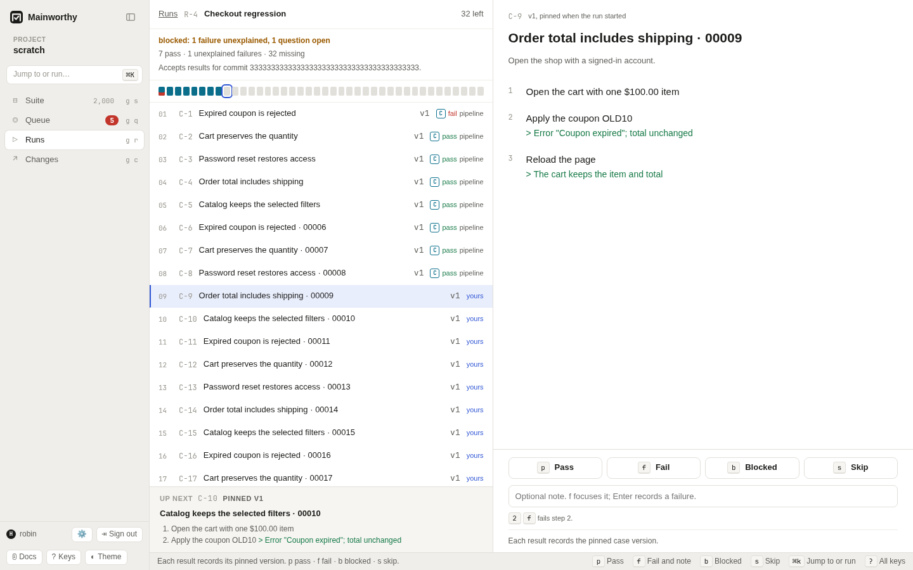

# Planned runs

Choose cases for a run, record results against their pinned versions, and close
with a verdict. Accept CI evidence so you do not repeat work already shown.



## Plan a run in the web app

1. Press <kbd>g</kbd> <kbd>r</kbd> to open Runs.
2. Press <kbd>n</kbd>.
3. Enter a "Run name".
4. Choose "All active cases", "By folder", "By tag", or "By search" under "Cases".
5. Supply the folder, tag, or search text when needed.
6. Choose which results the run accepts.
7. Choose "Plan run".

The planner shows the number of matching cases.
"Count only results recorded in this run" accepts work explicitly reported to the run.
"Accept results for a commit" also accepts qualifying results already reported for
that commit and results that arrive later. Enter the tested commit's hash.

A run counts one commit. An abbreviated hash is resolved against known commits at
planning time. If none is known yet, use the full hash your pipeline will report.
An ambiguous abbreviation is refused.

[Diagram: a planned run from plan to close](../diagrams/planned-run.html)

## Understand what each slot requests

Each selected case gets a slot pinned to its current version when you plan the run.
Editing, moving, or archiving the case later does not change that slot's version.
Read the pinned document in the run, rather than the latest document in Suite.

By default, a run asks for a person or an automated test, with one passing actor.
It accepts exact or assumed evidence under `loose` and `standard`.
Under `strict`, the default requires exact evidence.
A run can ask for other methods or two distinct passing actors through the CLI or API.

A person's result counts when the pinned case admits people.
An automated test counts when its link or annotation identifies the case and the
result meets the run's version rule.
An agent counts only when the run asks for agents and the pinned case admits them.
An agent's review is not a runtime pass. See [agents](./agents.md).

The web planner uses these policy defaults. It does not yet offer controls for
custom method requirements, required jobs, or actor assignments.
Use [the CLI](./cli.md) or [the API](./api.md) for those settings.

## Record results by hand

1. Select an unfilled slot.
2. Exercise the pinned case's steps.
3. Press the key for the outcome.

<kbd>p</kbd> records "Pass". <kbd>b</kbd> records "Blocked".
<kbd>s</kbd> records "Skip". These keys move you to the next missing slot.
<kbd>f</kbd> focuses "Result note". Enter the failure details, then press <kbd>Enter</kbd>
to record "Fail" and move on.

While the note has the focus, the outcome keys type letters and <kbd>Enter</kbd> records
"Fail". To record another outcome with a note, type the note, press <kbd>Esc</kbd> to
leave the field, then press the outcome key.

Type a step number before <kbd>f</kbd> to mark the failed step.
Use <kbd>j</kbd> and <kbd>k</kbd> to move between slots.
The run keeps unfinished notes on this device until the result is recorded.
See [the keyboard guide](./keyboard.md) for all run keys.

Blocked and skipped results record that the case was not proven. They do not satisfy
a slot, and a run with missing proof stays `pending`.
A failure opens a question. Answer it in [Queue](./decide.md).

Press <kbd>u</kbd> to correct the last result while the run remains open.
If there was no previous result, the correction is a skip. Both results stay recorded.
The web app requires you to reopen a closed run before recording or correcting results.
The reporting operation also accepts late results for closed runs that accept a commit.

## Let CI fill the run

A run that accepts a commit can use linked test results for that same commit.
Evidence already recorded fills qualifying slots when you plan the run.
Later reports fill qualifying slots even after a commit run closes.
The result must meet the slot's pinned version, method, and basis requirements.

An assumed result cannot fill a slot that requires an exact basis.
A pass on another case version does not count just because the title is unchanged.
See [report results](./report-results.md#read-the-results-basis).

The web app leaves slots filled by another producer for that producer's evidence.
Move to an unfilled slot to record your own work.
Use the reporting operation if your workflow needs several producers on one slot.

## Require CI jobs

Add named jobs when the run must receive reports from all parts of a pipeline.
Each required job needs an applied pipeline report that ran something.
A report made only of skipped or blocked results does not meet the requirement.
An agent's report under the same job name does not meet it either.
A run that counts only its own results cannot require CI jobs.

Use this CLI form for one case, one commit, and a required `tests` job:

```sh
$ mainworthy plan --json '{"name":"Checkout CI","select":{"cases":["C-1"]},"accepts":{"commit":"1111111111111111111111111111111111111111"},"require":[{"id":"exercise","kind":"exercise","methods":["human","auto"],"minActors":1,"basis":"exact"},{"id":"jobs","kind":"jobs","jobs":["tests"]}]}'
```

Match the job name to the report's detected job or explicit `--job` value.
A required job is separate from the evidence each case slot needs.

## Resolve a disputed slot

A counted pass and fail from different producers make a slot disputed.
A later write from another producer does not silently replace the disagreement.
Read the evidence in Queue and choose the appropriate failure answer.
"The failure was a mistake" lets the named passing evidence stand.

Under `standard` and `strict`, a person who produced the disputed evidence cannot
settle that dispute. See [policy](./policy.md).
The same retry rules used by commit gates apply to results within each producer's
job and target. See [report results](./report-results.md#preserve-attempts-and-retries).

## Close and reopen a run

When a planned run passes, Mainworthy raises a sign-off question.
Under `loose` and `standard`, a recorded rule normally approves and closes it.
Under `strict`, an authorized person approves with a reason in Queue.
Rejecting sign-off leaves the run open. You cannot approve a run that no longer passes.

A run that accepts a commit keeps receiving qualifying results after it closes,
including reports that name the run. While a report waits to be applied, its gate
is `pending`. Once all accepted reports are applied, Mainworthy asks for sign-off
again if a report added qualifying results to the run. A report for another
repository or environment the run excludes, or with no qualifying slot results,
leaves its approval in place. The ledger keeps a replaced approval and records
that it no longer holds. A passing run can close again under its policy; a run with
missing proof or unexplained failures stays open and cannot be approved.

A run that counts only results recorded in it takes no more results after closing.
To reopen one, find its sign-off in Queue's "Settled" view and withdraw that approval.
Newer decisions and the current policy still control who may withdraw it.

## Plan a run from the command line

```sh
$ mainworthy plan --json '{"name":"Checkout smoke","select":{"tags":["checkout"]}}'
```

The reply names the run, its slot count, and how many slots evidence already filled.
Use `mainworthy gate --run R-2` to read its verdict.
See [the CLI guide](./cli.md) for selection, methods, assignments, and other plan inputs.
