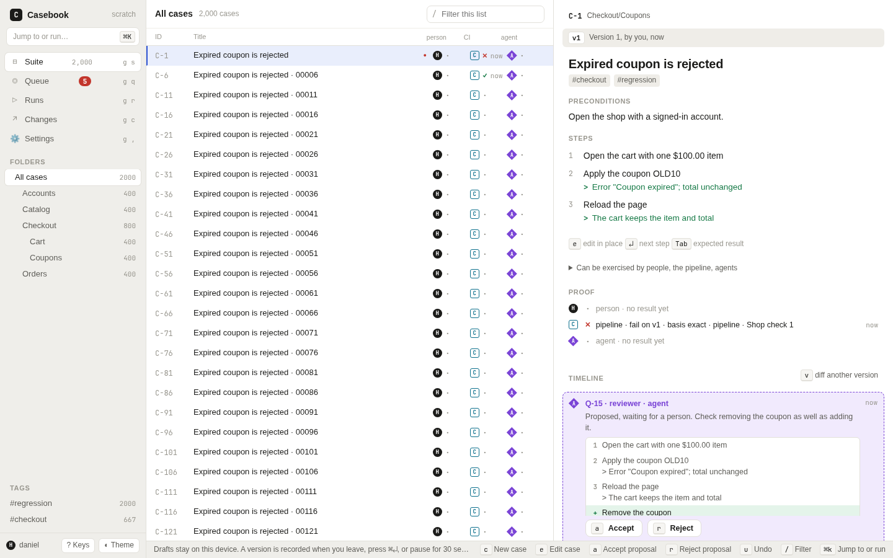
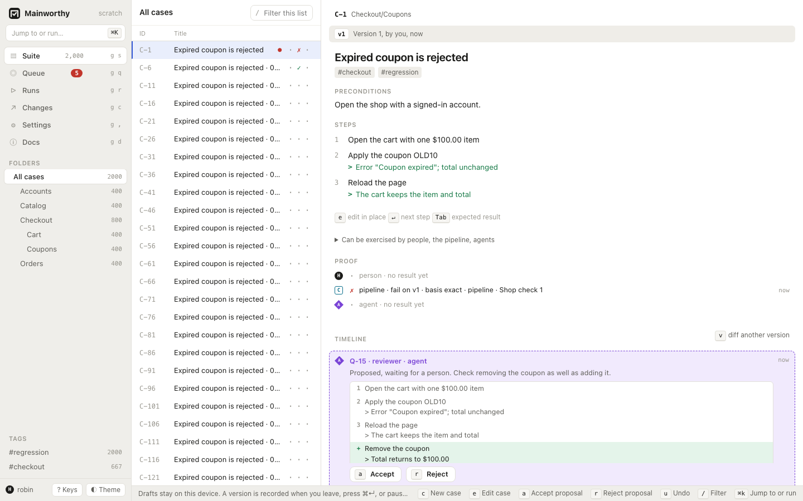

# Write cases

Write cases as outlines, keep their versions, and resolve edits that overlap.
Use folders, tags, and search to find the cases you need.



## Capture a case

1. Open Suite with <kbd>g</kbd> <kbd>s</kbd>.
2. Press <kbd>c</kbd>.
3. Type the title.
4. Press <kbd>Enter</kbd> to start the first step.
5. Type an action and its expected result, separated by ` > `.
6. Press <kbd>Enter</kbd> for the next step.
7. Press <kbd>Escape</kbd> to record the case and leave the editor.

Use <kbd>Tab</kbd> to move to the expected result field.
Press <kbd>Shift</kbd> <kbd>Enter</kbd> to record this case and start another.
The [keyboard guide](./keyboard.md) lists the remaining editor keys.

## Use the outline grammar

Put tags in the title with `#tag`. A space separates the tag from the title text.
Mainworthy removes recognized tags from the title and keeps them as tags.

```text
Checkout applies a percentage coupon #checkout #regression
  Open the cart with one $100.00 item
  Apply coupon SAVE10 > Total shows $90.00
  Reload the page > Coupon is still applied
```

When you paste a whole outline, indent the steps or start each with a list marker.
An unmarked first line is a title only when every following line is indented or marked.
A Markdown heading such as `# Coupon checkout` makes the title explicit.

You can paste numbered lists, bullet lists, or checkbox lists. Mainworthy removes
recognized list markers and splits each action from its expected result.
A deeper indented line continues the previous step's expected result.
A separate line beginning with `>` or `Expected:` also continues it.

You can paste two columns from a spreadsheet, with an action and an expected result.
Markdown tables work too. A header followed by a separator row is omitted.
A numeric first column can supply step numbers without becoming action text.

## Know what is saved

While you type, the editor keeps a private draft on this device.
A new draft has "Private, no version yet". For an existing case, others still see
the recorded version named beside your draft.

A dirty draft is submitted when you leave, press <kbd>Cmd</kbd> <kbd>Enter</kbd>
on macOS or <kbd>Ctrl</kbd> <kbd>Enter</kbd> elsewhere, or pause for 30 seconds.
The policy then decides whether the proposal becomes current or waits for review.
There is no save button.

The draft status says "Draft, saved on this device" when device storage works.
If storage is unavailable, it says "Draft, kept in this tab". Keep that tab open
until a version is recorded. Drafts do not sync between devices.

[Diagram: the life of a case](../diagrams/case-lifecycle.html)

## Read versions and restore earlier content

Select a case to read its version, author, proof, and timeline.
A result names the case version it exercised. Editing the case does not rewrite that result.



1. Press <kbd>v</kbd> to compare the current version with the one before it.
2. Select a version in the timeline to compare it with its preceding version.
3. Choose "Close" to dismiss the diff.

In Suite, <kbd>u</kbd> first undoes the latest placement action when one is available.
Otherwise, on a recorded case with more than one version, it restores the preceding
version as a new version. With a timeline version focused, it restores that version's
predecessor. The API can request a specific version to restore.
See [the API guide](./api.md) for that operation.

Restoring creates history. It never deletes or rewrites the earlier versions.
The web diff compares adjacent versions, rather than offering two arbitrary version selectors.

## Organize the suite

1. Press <kbd>n</kbd> <kbd>f</kbd> to create a folder.
2. Type its name.
3. Press <kbd>Enter</kbd>.

Creating a folder while inside another folder places it below that folder.
Select a folder in the sidebar to see its cases.

Press <kbd>x</kbd> on each case you want to select for a bulk action.
With no selection, the action uses the current case.
Press <kbd>m</kbd> to choose a destination folder.
Press <kbd>t</kbd> to add a tag, then enter the tag name.
Press <kbd>#</kbd> to archive the selected cases.
Press <kbd>u</kbd> to record the inverse of the latest placement action.

Moves, tag changes, and archiving appear in history without creating a new body version.
Archived cases leave the active suite. Their recorded history remains available.
Use [the API](./api.md) to return an archived case to active state.

Press <kbd>/</kbd> to focus "Filter cases". Type words to filter the current list.
Use the sidebar's tags to narrow the suite by tag.

## Resolve simultaneous edits

Edits to different fields can merge without a conflict. If two edits change the
same field differently, Mainworthy keeps both sides and shows "Both edits are kept".
The current version stays current while you resolve the conflict.

1. Read "Your draft" and "Current version" in the conflict card.
2. Choose a side for each field, or type the merged text.
3. Choose "Resolve conflict".

"Use all my changes" and "Keep current version" fill the merged body from one side.
Resolving submits a new proposal. It still follows the policy for ordinary edits.
If someone changes the case again meanwhile, the new edit merges or opens another conflict.

## Review under a stricter policy

Under `loose`, ordinary case proposals take effect at once.
Under `standard`, an agent's edit waits for a person. A person's ordinary edit still takes effect at once.
Under `strict`, ordinary edits wait for a person with a reason, including edits by people.

The case timeline shows the proposal and its diff. An authorized person can use
<kbd>a</kbd> to accept it or <kbd>r</kbd> to reject it.
Conflicts and policy changes have separate rules. See [policy](./policy.md).

## Write cases from the command line

```sh
$ mainworthy new coupon.txt
$ mainworthy get C-1 --md > coupon.md
$ mainworthy fmt coupon.md
```

`new` reads an outline or canonical case Markdown. It also accepts standard input.
`get --md` prints the stored case as canonical Markdown.
`fmt` parses canonical Markdown and prints its standard form without changing the server.
It needs no running instance. Parse errors name the source line.
See [the CLI guide](./cli.md) for command forms and flags.
